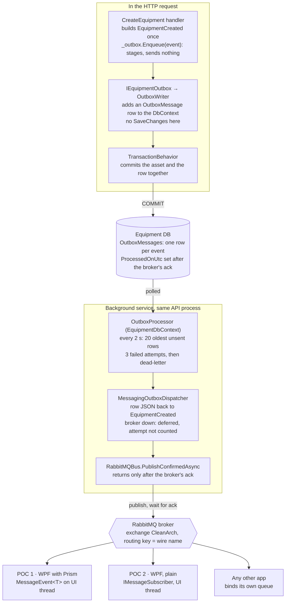

# How the API uses RabbitMQ

How the API's RabbitMQ messaging is written, why it is written that way, and how it works, with pseudo code and
examples. For the library manual (every app type, every setting), see [README.md](README.md).

Last reviewed: 2026-10-22, at commit `56e83db`.

## Contents

- [Why RabbitMQ is here](#why-rabbitmq-is-here)
- [The big picture](#the-big-picture)
- [Message contracts](#message-contracts)
- [The messaging library](#the-messaging-library)
- [Sending from the API](#sending-from-the-api)
- [Configuration and the on/off switch](#configuration-and-the-onoff-switch)
- [Receiving](#receiving)
- [Reliability](#reliability)
- [Correlation and telemetry](#correlation-and-telemetry)
- [Legacy compatibility](#legacy-compatibility)
- [Worked example: adding a new event](#worked-example-adding-a-new-event)
- [Gotchas and further reading](#gotchas-and-further-reading)

## Why RabbitMQ is here

RabbitMQ carries **integration events from the API to other applications**: today, Equipment's `EquipmentCreated`,
`EquipmentUpdated` and `EquipmentDeleted` go to desktop apps that need to know the inventory changed. It does one job,
and the API has two other mechanisms for related jobs.

| Mechanism | Job | Who receives | Guarantee |
| --- | --- | --- | --- |
| RabbitMQ | Tell *other applications* that something changed | Any app bound to the API's exchange (legacy WPF apps, modern WPF apps, other services) | At least once, survives restarts and broker outages |
| SignalR | Refresh *screens that are open right now* | Clients connected to `/hubs/presence` | Best effort, lost if nobody is connected |
| Outbox saga | Run a multi-step process *inside the API* across module databases | Other modules, called in-process | At least once, with compensation |

Why a broker instead of HTTP calls or SignalR for this job:

- **The sender doesn't know the receivers.** The API publishes once to its own exchange. Apps bind their own queues
  to it, so adding a receiver needs no change in the API.
- **Receivers can be offline.** A durable queue holds messages until its app comes back. SignalR can't do that.
- **The legacy apps already speak RabbitMQ.** The existing desktop estate uses `Common.RabbitMQ` and Prism events over
  RabbitMQ. The new library speaks the same wire format, so the API can talk to them without changing them.

Three rules shaped the design ([ADRs 0001-0003](adr/)):

1. **Handlers never see a transport.** A handler says *what happened*; the host decides *where it goes*. Domain and
   application code may not reference RabbitMQ, and a test enforces it.
2. **An event goes out if and only if its change was committed.** So the API never publishes directly; it publishes
   through the outbox.
3. **Legacy apps stay as they are.** Zero changes to `Common.RabbitMQ` or the wire format, and as few moving parts as
   possible.

## The big picture

An Equipment change becomes a RabbitMQ message in two halves. The request saves the event as a row next to the
change. A background service in the same API process then publishes that row and marks it sent only once the broker
confirms.



Read it top-down: the request half ends at the commit. The background half runs on its own timer, picks the row up
from the Equipment database, and hands it to the broker. The broker copies it to every queue bound to the `CleanArch`
exchange. The API doesn't know who those receivers are.

## Message contracts

A message is a plain class with a `[Message("wire name")]` attribute, living in a small project that receiving apps
can reference. Equipment's are in `src/Modules/Equipment/Equipment.Messages`:

```csharp
[Message("Equipment.EquipmentCreated")]   // the wire name: frozen forever
public sealed class EquipmentCreated
{
    public Guid   Id       { get; set; }
    public string Name     { get; set; } = "";
    public string Category { get; set; } = "";
    public string AssetTag { get; set; } = "";
    public string Status   { get; set; } = "";
}
```

Why each choice:

| Choice | Why |
| --- | --- |
| A separate project, `Equipment.Messages` | Other apps reference it. It's kept apart from `Equipment.Contracts`, which holds in-process interfaces only other modules use. |
| Targets `netstandard2.0` | Desktop apps on .NET Framework 4.7.2 and .NET 8 can both reference it. The API runs on .NET 10. |
| Only reference: `Messaging.Abstractions` | That's where `[Message]` lives, and it has no dependencies. A receiving app doesn't pull in RabbitMQ just to read the class. |
| `[Message("Equipment.EquipmentCreated")]` | The wire name is the message's identity, sent in the `event-type` header. It's never derived from the C# type, so the class can be renamed or moved without breaking receivers. |
| Plain get/set properties | System.Text.Json (server) and Newtonsoft.Json (legacy apps) read them the same way. |
| One class for both channels | The same object is the RabbitMQ message and the SignalR payload, so a client gets the same shape whichever way it listens. |

The rules for changing a contract, because other apps depend on it:

- Never change the wire name.
- Never rename or retype a property. Add a new one instead; old receivers ignore it.
- Keep the class plain data: no methods, no constructor logic, no inheritance.

Two names travel with every message, and they are easy to confuse:

- The **wire name** (`event-type` header) says **what** the message is. Receivers use it to pick the C# class.
- The **routing key** says **where** it goes. The broker matches it against queue bindings. By default it's the same
  string as the wire name, which is what legacy apps bind to.

## The messaging library

The library is **one engine with several front doors**. `RabbitMQBus` is the only code that talks to RabbitMQ; the
other projects translate between your code and that engine. It lives in `src/Messaging`.

| Project | Role | Used by |
| --- | --- | --- |
| `Messaging.Abstractions` | `[Message]`, `IMessagePublisher`, `IMessageHandler<T>`, `MessageContext`. No dependencies. | Contracts, every app |
| `Messaging.RabbitMQ` | `RabbitMQBus`, the engine: connect, declare, publish, consume, retry, reconnect. Knows nothing about DI or Prism. | Everything, indirectly |
| `Messaging.Hosting` | DI registration (`AddMessaging`), routes, handlers, subscribers, JSON, telemetry, `MessagingClient` for desktop apps | The API, modern WPF apps |
| `Messaging.Prism` | Bridges received messages to Prism's `IEventAggregator` as `MessageEvent<T>` | Modern WPF apps that keep Prism |
| `BuildingBlocks.Outbox.Messaging` | The outbox relay: `MessagingOutboxDispatcher<TContext>` | The API only |

### Bus, route, handler, subscriber

Four words cover the configuration. All of it happens in one `AddMessaging` call:

```csharp
services.AddMessaging(messaging => messaging
    .AddBus("Main", config.GetSection("Messaging:Buses:Main"))  // a connection + this app's exchange
    .Route<EquipmentCreated>().And()                             // EquipmentCreated is published on that bus
    .Handle<OrderSaved, OrderSavedHandler>().From("Main")       // a server class runs per received OrderSaved
    .Subscribe("OtherApp", "OtherApp.Events.#")                 // also receive from another app's exchange
    .AddTelemetry());                                            // traces, metrics, correlation-id header
```

- **Bus**: one connection to a broker plus this app's own exchange. An app can have several; the API has one, `Main`.
- **Route**: which bus a message class is published on, and with which routing key (the wire name by default).
- **Handler**: an `IMessageHandler<T>` class, resolved in its own DI scope for every received message. For servers.
- **Subscriber**: `IMessageSubscriber.Subscribe<T>(callback)` at runtime, for view models and other code that isn't a
  DI handler.

The API only publishes, so it uses buses and routes. Handlers and subscribers are for receivers.

### Two ways to publish

The engine has two publish paths. The difference is what "done" means.

| | `IMessagePublisher.PublishAsync` | `IConfirmedMessagePublisher.PublishConfirmedAsync` |
| --- | --- | --- |
| Returns when | The message is serialized and in an in-memory buffer | The broker has confirmed it |
| Broker down | Message waits in the buffer | Throws `BrokerUnavailableException` |
| Process crashes | Buffered messages are lost | Nothing was promised yet; the caller retries |
| Used by | Legacy-style apps | The API's outbox relay |

In pseudo code:

```
PublishAsync(message):
    bytes = serialize(message)                // now, so later edits don't change what's sent
    buffer.add(bytes, wireName, routingKey)
    return                                    // caller carries on immediately

    background loop:
        for each item in buffer:
            publish to own exchange, wait for broker confirm
            remove from buffer only after the confirm

PublishConfirmedAsync(message, messageId):
    if stopped or not connected: throw BrokerUnavailableException
    for each bus the message is routed to:
        publish(bytes, headers, message-id = messageId, mandatory = true)
        wait up to 30 s for the broker's confirm
            confirmed            -> done
            returned (no queue)  -> log "No queue is bound ...", done
            nack, no confirm in 30 s, connection dropped
                                 -> throw BrokerUnavailableException
```

The API uses only the confirmed path. A buffered publish could report success while the message is still in memory,
and the outbox would then mark the row sent and lose it on a restart ([ADR 0003](adr/0003-server-publishes-through-the-outbox.md)).

### What goes on the wire

Every message is JSON plus a few headers:

| Header | When | Meaning |
| --- | --- | --- |
| `event-type` | Always | The wire name: what the message is |
| `source-id` | Always | Which running program sent it; used to drop echoes |
| `correlation-id` | With `AddTelemetry()` | Ties the message to the request that caused it |
| `traceparent`, `tracestate` | With `AddTelemetry()` | Distributed tracing |
| message-id (AMQP property) | Confirmed publishes | The outbox row's id, so a resend keeps the same id |

Receivers ignore headers they don't know, so headers can be added without breaking anyone.

## Sending from the API

The API sends in two phases: **the request saves the event as a database row, and a background service publishes that
row later**. Nothing is sent to RabbitMQ while the request runs. This is the transactional outbox pattern.

### Why not publish straight from the handler?

Publishing directly gives two bad outcomes, both real:

- **Publish, then the commit fails.** Other apps hear about equipment that was never saved.
- **Commit, then the publish fails** (broker down, process killed). The equipment exists, but nobody is ever told.

The outbox removes both. The event is a row in the same database as the change, saved in the same transaction. Either
both exist or neither does. A separate loop then keeps trying until the broker confirms.

### Phase 1: inside the request

The handler builds the event and hands it to its module's outbox (`CreateEquipment.cs:55-64`):

```csharp
var created = new EquipmentCreated { Id = asset.Id, Name = asset.Name, ... };
_outbox.Enqueue(created);   // RabbitMQ, via the outbox
_realtime.Publish(RealtimeGroups.Equipment(), new RealtimeEvent(nameof(EquipmentCreated), created));  // SignalR
```

`_outbox` is an `IEquipmentOutbox`. With messaging on, it's `EquipmentOutbox`, which forwards to the shared
`OutboxWriter<EquipmentDbContext>`:

```
OutboxWriter.Enqueue(event):
    db.OutboxMessages.Add(new OutboxMessage {
        Id            = new Guid,
        Type          = "EquipmentCreated",           // short class name
        Content       = JSON of the event,
        OccurredOnUtc = now,
        CorrelationId = the current request's correlation id
    })
    // no SaveChanges here
```

It only *adds* the row to the DbContext. `TransactionBehavior` then commits the asset and the row together. If the
handler or the commit throws, both are rolled back.

Why `IEquipmentOutbox` and not the shared `IOutbox`? `IOutbox` is a single DI registration, and Onboarding already owns
it for its saga. Equipment gets its own interface so the two don't collide, but both wrap the same `OutboxWriter`, so
every outbox row has the same format.

### Phase 2: the background relay

`OutboxProcessor<EquipmentDbContext>` is a hosted service that starts with the API (`OutboxProcessor.cs`):

```
every 2 seconds:
    rows = OutboxMessages where ProcessedOnUtc is null and DeadLetteredOnUtc is null
           order by OccurredOnUtc, take 20

    for each row:
        row.Attempts += 1
        restore row.CorrelationId into this scope
        try:
            dispatcher.DispatchAsync(row.Id, row.Type, row.Content)
            row.ProcessedOnUtc = now                         // sent
        catch OutboxDeliveryDeferredException:              // broker down
            row.Attempts -= 1                                // not the message's fault
            stop this batch                                  // keep the order; retry next poll
        catch any other exception:
            if row.Attempts >= 3: row.DeadLetteredOnUtc = now
            else: leave it for the next poll

    SaveChanges
```

The processor is generic: it knows nothing about RabbitMQ. The RabbitMQ part is the dispatcher,
`MessagingOutboxDispatcher<EquipmentDbContext>`:

```
DispatchAsync(rowId, type, content):
    messageType = lookup(type)            // "EquipmentCreated" -> typeof(EquipmentCreated)
                                          // unknown -> InvalidOperationException (counts as a failed attempt)
    message = JSON.deserialize(content, messageType)
    carry the correlation id into the messaging library
    try:
        await confirmedPublisher.PublishConfirmedAsync(message, messageId: rowId)
    catch BrokerUnavailableException:
        throw OutboxDeliveryDeferredException   // tells the processor: retry later, don't count it
```

The type list comes from `AddOutboxPublishing<EquipmentDbContext>(typeof(EquipmentCreated), ...)`. Two classes with
the same short name are refused at startup, because the row's `Type` column couldn't tell them apart.

### Why it's split into three pieces

| Piece | Project | Knows about |
| --- | --- | --- |
| `OutboxWriter`, `OutboxProcessor` | `BuildingBlocks.Outbox` | EF Core only. Also used by Onboarding's saga. |
| `MessagingOutboxDispatcher` | `BuildingBlocks.Outbox.Messaging` | The outbox and the messaging library |
| `RabbitMQBus` | `Messaging.RabbitMQ` | RabbitMQ only |

The generic outbox stays free of RabbitMQ, so a module can use it for in-process work without a broker. The relay is
the one small piece that connects the two.

## Configuration and the on/off switch

RabbitMQ is on **only when `Messaging:Buses:Main` exists in configuration**. Today that section is only in
`appsettings.Development.json`, so Development publishes and other environments don't, until you add it.

```json
"Messaging": {
  "Buses": {
    "Main": {
      "HostName": "localhost", "Port": 5672, "VirtualHost": "/",
      "UserName": "guest", "Password": "guest",
      "ExchangeName": "CleanArch",     // the API's own exchange; receivers bind to this name
      "ClientName": "CleanArch.Api",
      "QueueMode": "Shared"            // server style: one durable queue shared by all API instances
    }
  }
}
```

The host wires it up in `Program.cs:62-77`. This is the one place that decides *where* events go:

```csharp
var messagingBus = builder.Configuration.GetSection("Messaging:Buses:Main");
if (messagingBus.Exists())
{
    builder.Services.AddMessaging(messaging => messaging
        .AddBus("Main", messagingBus)
        .Route<EquipmentCreated>().And()
        .Route<EquipmentUpdated>().And()
        .Route<EquipmentDeleted>().And()
        .AddTelemetry());

    builder.Services.AddEquipmentIntegrationEvents();   // the module says WHICH events it publishes
}
```

What each switch position does:

| | Section present | Section missing |
| --- | --- | --- |
| `IEquipmentOutbox` | `EquipmentOutbox`: writes rows | `NoBrokerEquipmentOutbox`: does nothing |
| Outbox rows in the Equipment DB | Written with every change | None |
| `OutboxProcessor<EquipmentDbContext>` | Running | Not registered |
| RabbitMQ connection | Opened at startup, reconnects on its own | None |
| SignalR | Works | Works, unchanged |
| Handler code | Identical | Identical |

How the swap works: the module registers the do-nothing outbox with `TryAddScoped`. `AddEquipmentIntegrationEvents`
removes it and registers the real one, plus `AddOutboxPublishing`. So the handler always gets an `IEquipmentOutbox`
and never checks whether messaging is on.

Why a missing broker turns messaging off instead of failing: a developer without RabbitMQ installed still gets a
working API, and no outbox rows pile up with nothing to send them.

There's deliberately **no messaging health check on `/health`**. It would report Unhealthy while the broker is down
and take the API out of the load balancer, for an outage the outbox already absorbs: events wait and go out
afterwards.

For production, `guest`/`guest` only works from the broker's own machine. Give the API its own broker account and
keep the password out of `appsettings.json` (environment variable or secret store).

## Receiving

A receiving app **binds its own queue to the API's exchange, `CleanArch`**, and registers the message classes it
wants. The API knows nothing about it. The working examples are POC 1 and POC 2 in
[`samples/MessagingPocs`](../../samples/MessagingPocs/README.md).

### What the receiver configures

```json
"Messaging": { "Buses": { "Main": {
    "HostName": "localhost", ...,
    "ExchangeName": "Poc.PlainApp",              // its own exchange (unused if it never publishes)
    "ClientName": "Poc.PlainApp",
    "Subscriptions": [ { "Exchange": "CleanArch" } ]   // listen to the API's exchange
} } }
```

No routing keys in the subscription means *one binding per message type this app registered*, keyed by wire name. So
`AddMessages(typeof(EquipmentCreated).Assembly)` registers the three Equipment classes, and the app gets three
bindings: `Equipment.EquipmentCreated`, `Equipment.EquipmentUpdated`, `Equipment.EquipmentDeleted`.

### What happens when a message arrives

```
on message from queue:
    if source-id == this program: skip               // an echo of our own message
    wireName = header "event-type" (or routing key)
    type = registry[wireName]                        // "Equipment.EquipmentCreated" -> EquipmentCreated
    if unknown: skip                                 // desktop queue
    message = JSON.deserialize(body, type)
    run handlers, then sinks (subscribers, Prism bridge)
    ack                                              // broker deletes it
```

### Option A: plain .NET 8 app (POC 2)

The Generic Host runs messaging as a hosted service, and view models subscribe with `IMessageSubscriber`:

```csharp
// App startup
builder.Services.AddMessaging(messaging => messaging
    .AddBus("Main", builder.Configuration.GetSection("Messaging:Buses:Main"))
    .AddMessages(typeof(EquipmentCreated).Assembly));   // what to receive

// View model, created on the UI thread
_ui = SynchronizationContext.Current;
_subscriptions.Add(subscriber.Subscribe<EquipmentCreated>(List.Apply, _ui));  // runs on the UI thread

// Dispose
foreach (var s in _subscriptions) s.Dispose();   // strong references: always unsubscribe
```

### Option B: .NET 8 app that keeps Prism (POC 1)

`MessagingClient` hosts messaging inside a Prism app, and `UseEventAggregator` raises each message as a Prism event:

```csharp
var client = MessagingClient.Create(services => services.AddMessaging(messaging => messaging
    .AddBus("Main", configuration.GetSection("Messaging:Buses:Main"))
    .AddMessages(typeof(EquipmentCreated).Assembly)
    .UseEventAggregator(eventAggregator)));

eventAggregator.GetEvent<MessageEvent<EquipmentCreated>>()
    .Subscribe(List.Apply, ThreadOption.UIThread);
```

### Rules both options share

- **Register what you receive.** Subscribing to a class that isn't registered compiles and runs, and never fires.
- **Update the UI on the UI thread.** Messages arrive on a RabbitMQ thread. Pass the UI `SynchronizationContext`
  (Option A) or `ThreadOption.UIThread` (Option B).
- **Subscribe before starting.** A message that arrives before anyone subscribed is received and dropped.
- **Reload when the connection comes back.** A desktop app's queue is per-instance and is deleted when its connection
  drops. Events sent while it was disconnected are gone, so reload the list from the API on reconnect.
- **Prism holds weak references.** Subscribe with a method group on a long-lived object, not a lambda that captures a
  local, or the subscription silently disappears at the next garbage collection.
- **Desktop apps only listen.** No `Route<T>()` and no publisher. Changes go to the API over HTTP. Give desktop apps a
  restricted broker account that can't publish to `CleanArch`.

### Desktop vs server queues

| | Per-instance (desktop) | Shared (server) |
| --- | --- | --- |
| Queues | One per running program | One per service, shared by its instances |
| Each message goes to | Every running copy | One copy |
| Lifetime | Deleted when the program exits | Durable; messages wait while nothing runs |
| Handler throws | Logged and dropped | Retried 3 times, 1 s apart, then dead-lettered |
| Setting | `QueueMode: PerInstance` (default) | `QueueMode: Shared` |

If all your events come from the API and the app only needs live updates, SignalR (POC 3) is simpler: no broker
account on each desktop. Use RabbitMQ when the app also needs events the API never sees, such as those legacy apps
publish.

## Reliability

The guarantee is: **an event reaches the broker if and only if its change was committed, and it may arrive more than
once.** Every failure below ends in one of three places: sent later, dead-lettered for a person to look at, or never
written because the change rolled back.

| What goes wrong | What happens | Where it ends |
| --- | --- | --- |
| Validation or a domain rule fails in the handler | Transaction rolls back; no outbox row exists | Nothing sent, correctly |
| The commit fails | Same: change and row roll back together | Nothing sent, correctly |
| API crashes right after the commit | Row is in the database; the processor finds it after restart | Sent later |
| RabbitMQ down for seconds or hours | Dispatcher throws `OutboxDeliveryDeferredException`; attempt not counted; batch stops to keep order | Sent, in order, once the broker is back |
| Connection drops mid-publish | `BrokerUnavailableException` → deferred, as above | Sent later |
| Broker refuses the message (nack), e.g. a receiver's full queue | `BrokerUnavailableException` → deferred | Sent later |
| Broker blocks publishers (memory or disk alarm), or the link is half-open | No confirm within 30 s → `BrokerUnavailableException` → deferred | Sent later, possibly twice |
| API shutting down while the processor polls | Bus already stopped → `BrokerUnavailableException` → deferred | Sent after restart |
| No queue is bound for the routing key | Published as mandatory, so the broker returns it; logged as "No queue is bound …" | Marked sent; nobody received it |
| No route for the class, bad JSON, unknown type | Counts as a failed attempt; retried every 2 s | Dead-lettered after 3 attempts (`DeadLetteredOnUtc` set) |
| Broker confirms, then the API crashes before saving `ProcessedOnUtc` | Row still looks unsent; it's published again after restart | **Duplicate**, same message-id |
| Receiver's handler throws (server, shared queue) | Retried 3 times, 1 s apart, in the receiver | Receiver's `<queue>.dead-letter` |
| Receiver's handler throws (desktop) | Logged and acked, as legacy apps always did | Dropped |
| Desktop app offline | Its per-instance queue doesn't exist | Missed; it reloads from the API on reconnect |

### Receivers must handle duplicates

At-least-once means a receiver can see the same event twice. The message-id is the outbox row's id and never changes
on a resend, so a receiver can skip what it has already handled:

```
on EquipmentCreated(message, context):
    if processed.contains(context.MessageId): return
    apply(message)
    processed.add(context.MessageId)
```

For these events a simpler rule often works: make the handler an upsert. Applying "equipment X now looks like this"
twice gives the same result as applying it once. That's what the POC list's `Apply` does.

### Why a broker outage doesn't use up attempts

The processor dead-letters a row after 3 failed attempts, 2 seconds apart. If a broker outage counted, any outage
longer than about 6 seconds would park perfectly good messages. So the dispatcher separates "the broker isn't there"
(deferred, free) from "this message is broken" (counts). The batch also stops at the first deferred row, so messages
can't overtake each other while the broker is down.

### Dead letters

A dead-lettered row stays in the Equipment database with its `Error` text. Onboarding has admin endpoints to search
and replay its dead letters (`AddOutboxAdmin`). Equipment doesn't yet, because those services are registered once and
Onboarding owns them. Until then, a dead-lettered Equipment row is fixed with SQL: correct the cause, then clear
`DeadLetteredOnUtc` and `Attempts`.

## Correlation and telemetry

One correlation id follows a change **from the HTTP request, through the outbox row, onto the RabbitMQ message, into
the receiving app**, even though the publish happens seconds later on another thread.

```
HTTP request             X-Correlation-ID: 7f3a...  (or a new one)
  -> OutboxWriter         row.CorrelationId = 7f3a...
  ... up to 2 s later, background thread ...
  -> OutboxProcessor      correlation.Set(row.CorrelationId)
  -> MessagingOutboxDispatcher
        using MessagingCorrelation.Begin(7f3a...)   // hand it to the messaging library
        PublishConfirmedAsync(...)                   // header correlation-id: 7f3a...
  -> receiving app        context.CorrelationId == 7f3a...
```

The hand-over in the dispatcher is needed because the API and the messaging library each keep their own ambient
correlation context. The processor restores the API's; the dispatcher copies it into the library's for the duration
of the publish.

On the receiving side, the async `Subscribe` overload gets a `MessageContext` with `MessageId` (the outbox row id) and
`CorrelationId`. Log both, and one change can be followed from the request log in the API to the receiving app.

### Metrics and traces

`.AddTelemetry()` in `AddMessaging` turns on tracing, metrics and the `correlation-id` and `traceparent` headers.
`Observability.cs` adds the `Messaging` source and meter to OpenTelemetry, so they reach the Grafana stack with
everything else.

| Metric | Meaning |
| --- | --- |
| `messaging.client.sent.messages` | Messages the broker confirmed |
| `messaging.client.consumed.messages` | Messages received |
| `messaging.process.duration` | Time spent handling a received message, in seconds |
| `outbox_delivered_total` | Outbox rows sent |
| `outbox_failed_total` | Failed attempts that will be retried |
| `outbox_dead_lettered_total` | Rows given up on |

A rising `outbox_dead_lettered_total` needs a person. Deferred rows during a broker outage don't show up as failures;
they show up as a growing backlog of unsent rows.

## Legacy compatibility

Old and new apps talk because **they share one engine and one wire format, and agree on wire names**. A legacy app
keeps its Prism events and `App.config`; the API publishes plain classes. On the broker, both look the same.

### How the library got here

The code in `src/Messaging` and `src/Common.RabbitMQ` is a copy of the RabbitMQ-Refactor repository at commit
`5a605a1` (2026-09-27, see [PROVENANCE.md](PROVENANCE.md)). It replaced this repo's earlier `Common.RabbitMQ`, whose
envelope format legacy apps couldn't read. It's a copy, not a NuGet package, because legacy .NET Framework projects
reference the adapter by relative path.

The original `Common.RabbitMQ` had problems [ADR 0001](adr/0001-decouple-messaging-from-prism.md) set out to fix:

- Contracts were Prism types (`EmployeeSaved : RemotePubSubEvent<Employee>`), so every sender and receiver needed
  Prism.
- The transport took `IEventAggregator` in its constructor and could only deliver into Prism.
- The API got desktop behaviour: synchronous handlers, weak references, no DI scope, no retry or dead-letter.

### The layering that fixed it

```
legacy WPF (net472)  -> Common.RabbitMQ (Prism adapter, public API unchanged) --\
modern WPF (net8)    -> Messaging.Hosting [+ Messaging.Prism]                   -> Messaging.RabbitMQ -> broker
CleanArch.Api        -> Messaging.Hosting -> outbox relay                    --/
```

The test for this design: when the last legacy app is retired, deleting `Common.RabbitMQ` needs no change in
`src/Messaging`.

### What each side writes

```csharp
// Legacy app: unchanged Prism code
public class OrderSaved : PubSubEvent<Order> { }
eventAggregator.GetEvent<OrderSaved>().PublishRemote(order);
eventAggregator.GetEvent<OrderSaved>().Subscribe(OnOrderSaved, ThreadOption.UIThread);

// New code: a plain class with the legacy event's full name as its wire name
[Message("Common.Events.EmployeeSaved")]
public class EmployeeSaved { public int Id { get; set; } public string Name { get; set; } }
```

The rules that keep them compatible:

- **A message a legacy app must receive uses the legacy event's full .NET type name as its wire name.** Legacy apps
  identify messages by type name; new code declares it explicitly.
- **Keep the default routing key** (the wire name) for anything legacy apps receive. Legacy apps bind by wire name, so
  a custom routing key never reaches them.
- **JSON must be identical.** The server serializes with System.Text.Json configured to produce the same bytes as
  legacy Newtonsoft.Json. Golden-file tests in `tests/Common.RabbitMQ.Tests` compare the bytes, and a frozen copy of
  the original library checks it can still receive them.
- **Legacy apps keep their buffered publishing.** ADR 0003 changes nothing for them: same adapter, same behaviour if
  they crash with messages in the buffer.

Equipment's events use new-style wire names (`Equipment.EquipmentCreated`) because no legacy app consumes them today.
A message meant for legacy apps would follow the rules above instead.

## Worked example: adding a new event

Say Equipment should tell other apps when an asset is **retired**. It takes five small changes, in four places. The
handler change is two lines.

**1. The contract** in `Equipment.Messages`:

```csharp
[Message("Equipment.EquipmentRetired")]
public sealed class EquipmentRetired
{
    public Guid Id { get; set; }
    public string Reason { get; set; } = "";
}
```

**2. The handler** stages it, inside the same unit of work as the change:

```csharp
public async Task<Unit> Handle(Command command, CancellationToken ct)
{
    var asset = await _equipment.GetAsync(command.Id, ct);
    asset.Retire(command.Reason);

    var retired = new EquipmentRetired { Id = asset.Id, Reason = command.Reason };
    _outbox.Enqueue(retired);                                    // RabbitMQ, after the commit
    _realtime.Publish(RealtimeGroups.Equipment(),                // SignalR, optional
        new RealtimeEvent(nameof(EquipmentRetired), retired));
    return Unit.Value;
}
```

**3. The module** lists it as one of its outbox types, in `AddEquipmentIntegrationEvents`:

```csharp
services.AddOutboxPublishing<EquipmentDbContext>(
    typeof(EquipmentCreated), typeof(EquipmentUpdated), typeof(EquipmentDeleted),
    typeof(EquipmentRetired));   // new
```

**4. The host** routes it, in `Program.cs`:

```csharp
.Route<EquipmentDeleted>().And()
.Route<EquipmentRetired>().And()   // new
```

**5. A receiver** subscribes. `AddMessages(typeof(EquipmentCreated).Assembly)` already picks up the new class, so only
the subscription is new:

```csharp
_subscriptions.Add(subscriber.Subscribe<EquipmentRetired>(List.Apply, _ui));
```

### What breaks if you skip a step

| Skipped | Symptom |
| --- | --- |
| 3, the outbox type | Row is written, then fails with "Unknown outbox message type 'EquipmentRetired'" and is dead-lettered after 3 attempts |
| 4, the route | The publish fails because the class has no bus; also dead-lettered after 3 attempts |
| The receiver's `AddMessages` | No binding for the new wire name; the queue never gets the message, and nothing errors |

### Check it works

1. Start RabbitMQ on `localhost:5672`.
2. Run the API in Development, so the `Messaging` section is present.
3. Retire an asset through Swagger.
4. Within about 2 seconds the row's `ProcessedOnUtc` is set in the Equipment DB, and the RabbitMQ management page shows
   a message published to `CleanArch` with routing key `Equipment.EquipmentRetired`.

Two test suites guard the design: `TransportIndependenceTests` fails if a domain, application or contract assembly
references RabbitMQ, the outbox relay or SignalR, and `OutboxMessagingTests` covers the relay.

## Gotchas and further reading

### Gotchas

- **"Enqueue" and "Publish" in a handler send nothing.** They stage. Sending happens after the commit (SignalR) or on
  the next poll (RabbitMQ).
- **No `Messaging` section, no events, no error.** `NoBrokerEquipmentOutbox` silently discards. If receivers hear
  nothing, check the config first.
- **The API never calls `IMessagePublisher` for events other apps rely on.** Always the outbox. A direct buffered
  publish can be lost on a crash.
- **Equipment uses `IEquipmentOutbox`, not `IOutbox`.** `IOutbox` belongs to Onboarding's saga. Injecting it in an
  Equipment handler would add the row to the Onboarding DbContext, outside Equipment's transaction.
- **Each outbox type needs a unique short class name.** The row stores `typeof(T).Name`, so two `Created` classes in
  different namespaces are refused at startup.
- **A broker outage stops the batch.** Rows behind a deferred row wait, which keeps order. If Onboarding ever shares its
  outbox with RabbitMQ, saga steps would wait too ([tutorial 67](../../tutorials/67-messaging-with-rabbitmq.md),
  section B).
- **Changing a shared queue's settings fails at the broker.** A queue's arguments can't change once it exists. The bus
  logs which queue; put the setting back, or delete the queue and lose its messages.
- **Desktop queues disappear with their connection.** Reload from the API after a reconnect.
- **An event nobody is bound for is marked sent.** That's deliberate: holding it would stall the outbox whenever no
  receiver runs. The "No queue is bound …" log line is how a missing or mistyped binding shows up.

### Not built yet

- Onboarding publishing to RabbitMQ.
- The API *receiving* messages (no handlers registered).
- Dead-letter search and replay endpoints for Equipment's outbox.

### Further reading

| Document | Read it for |
| --- | --- |
| [README.md](README.md) | The library manual: glossary, recipes for each app type, configuration reference, troubleshooting |
| [ADR 0001](adr/0001-decouple-messaging-from-prism.md) | Why the library is layered the way it is |
| [ADR 0002](adr/0002-exchange-per-owner-and-configurable-routing.md) | Exchange per application, routing keys, bindings |
| [ADR 0003](adr/0003-server-publishes-through-the-outbox.md) | Why the API publishes through the outbox with a confirmed publish |
| [Tutorial 67](../../tutorials/67-messaging-with-rabbitmq.md) | Step-by-step build of the Equipment events, and the shared-outbox design |
| [MessagingPocs README](../../samples/MessagingPocs/README.md) | Running the three desktop POCs against the API |
