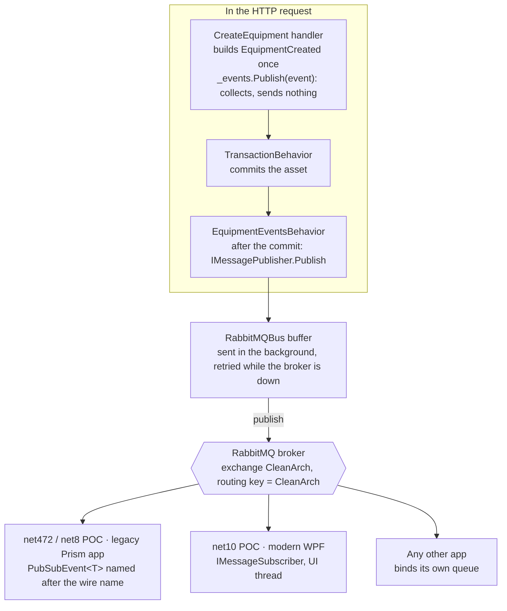

# How the API uses RabbitMQ

How the API's RabbitMQ messaging is written, why it is written that way, and how it works, with pseudo code and
examples. For the library manual (every app type, every setting), see [README.md](README.md).

Last reviewed: 2026-11-05. The outbox was removed that day: the API now publishes right after the commit.

## Contents

- [Why RabbitMQ is here](#why-rabbitmq-is-here)
- [The big picture](#the-big-picture)
- [Message contracts](#message-contracts)
- [The messaging library](#the-messaging-library)
- [Sending from the API](#sending-from-the-api)
- [Configuration and the on/off switch](#configuration-and-the-onoff-switch)
- [Receiving](#receiving)
- [Reliability](#reliability)
- [Monitoring](#monitoring)
- [Legacy compatibility](#legacy-compatibility)
- [Worked example: adding a new event](#worked-example-adding-a-new-event)
- [Gotchas and further reading](#gotchas-and-further-reading)

## Why RabbitMQ is here

RabbitMQ carries **integration events from the API to other applications**: today, Equipment's `EquipmentCreated`,
`EquipmentUpdated` and `EquipmentDeleted` go to desktop apps that need to know the inventory changed. It does one job,
and the API has two other mechanisms for related jobs.

| Mechanism | Job | Who receives | Guarantee |
| --- | --- | --- | --- |
| RabbitMQ | Tell *other applications* that something changed | Any app bound to the API's exchange (legacy WPF apps, modern WPF apps, other services) | Best effort: survives broker outages while the API keeps running, lost if the API stops first |
| SignalR | Refresh *screens that are open right now* | Clients connected to `/hubs/presence` | Best effort, lost if nobody is connected |
| Outbox saga | Run a multi-step process *inside the API* across module databases | Other modules, called in-process | At least once, with compensation |

Why a broker instead of HTTP calls or SignalR for this job:

- **The sender doesn't know the receivers.** The API publishes once to its own exchange. Apps bind their own queues
  to it, so adding a receiver needs no change in the API.
- **Receivers can be offline.** A durable queue holds messages until its app comes back. SignalR can't do that.
- **The legacy apps already speak RabbitMQ.** The existing desktop estate uses `Common.RabbitMQ` and Prism events over
  RabbitMQ. The new library speaks the same wire format, so the API can talk to them without changing them.

Three rules shaped the design ([ADRs 0001-0002](adr/)):

1. **Handlers never see a transport.** A handler says *what happened*; the host decides *where it goes*. Domain and
   application code may not reference RabbitMQ, and a test enforces it.
2. **An event never goes out for a change that rolled back.** Events are collected while the command runs and published
   only after its transaction commits.
3. **Legacy apps stay as they are.** Zero changes to `Common.RabbitMQ` or the wire format, and as few moving parts as
   possible.

## The big picture

A handler collects the event while the command runs. Once the transaction has committed, the event goes to the bus,
which buffers it in memory and sends it to the broker in the background.



The broker copies the message to every queue bound to the `CleanArch` exchange. The API doesn't know who those
receivers are.

## Message contracts

A message is a plain class with a `[Message("wire name")]` attribute, living in a small project that receiving apps
can reference. Equipment's are in `src/Modules/Equipment/Equipment.Messages`:

```csharp
[Message("Equipment.EquipmentCreated")]   // the wire name: frozen forever
public sealed class EquipmentCreated
{
    public Guid   Id       { get; set; }
    public string Name     { get; set; } = "";
    public string Category { get; set; } = "";
    public string AssetTag { get; set; } = "";
    public string Status   { get; set; } = "";
}
```

Why each choice:

| Choice | Why |
| --- | --- |
| A separate project, `Equipment.Messages` | Other apps reference it. It's kept apart from `Equipment.Contracts`, which holds in-process interfaces only other modules use. |
| Targets `netstandard2.0` | Desktop apps on .NET Framework 4.7.2 and .NET 8 can both reference it. The API runs on .NET 10. |
| Only reference: `Messaging.Abstractions` | That's where `[Message]` lives, and it has no dependencies. A receiving app doesn't pull in RabbitMQ just to read the class. |
| `[Message("Equipment.EquipmentCreated")]` | The wire name is the message's identity, sent in the `event-type` header. It's never derived from the C# type, so the class can be renamed or moved without breaking receivers. |
| Plain get/set properties | System.Text.Json (server) and Newtonsoft.Json (legacy apps) read them the same way. |
| One class for both channels | The same object is the RabbitMQ message and the SignalR payload, so a client gets the same shape whichever way it listens. |

The rules for changing a contract, because other apps depend on it:

- Never change the wire name.
- Never rename or retype a property. Add a new one instead; old receivers ignore it.
- Keep the class plain data: no methods, no constructor logic, no inheritance.

Two names travel with every message, and they are easy to confuse:

- The **wire name** (`event-type` header) says **what** the message is. Receivers use it to pick the C# class.
- The **routing key** says **where** it goes. The broker matches it against queue bindings. By default it's the same
  string as the wire name, which is what legacy apps bind to.

## The messaging library

The library is **one engine with several front doors**. `RabbitMQBus` is the only code that talks to RabbitMQ; the
other projects translate between your code and that engine. It lives in `src/Messaging`.

| Project | Role | Used by |
| --- | --- | --- |
| `Messaging.Abstractions` | `[Message]`, `IMessagePublisher`, `IMessageHandler<T>`, `MessageContext`. No dependencies. | Contracts, every app |
| `Messaging.RabbitMQ` | `RabbitMQBus`, the engine: connect, declare, publish, consume, retry, reconnect. Knows nothing about DI or Prism. | Everything, indirectly |
| `Messaging.Hosting` | DI registration (`AddMessaging`), handlers, subscribers, JSON, `MessagingClient` for desktop apps | The API, modern WPF apps |
| `Messaging.Prism` | Bridges received messages to Prism's `IEventAggregator` as `MessageEvent<T>` | Modern WPF apps that keep Prism |

### Bus, handler, subscriber

Three words cover the configuration. All of it happens in one `AddMessaging` call:

```csharp
services.AddMessaging(messaging => messaging
    .AddBus("Main", config.GetSection("Messaging:Buses:Main"))  // a connection + this app's exchange
    .AddHandlers(typeof(OrderSavedHandler).Assembly)            // every IMessageHandler<T> in it, on every bus
    .Subscribe("OtherApp", "OtherApp.Events.#"));               // also receive from another app's exchange
```

- **Bus**: one connection to a broker plus this app's own exchange. An app can have several; the API has one, `Main`.
- **Publishing** needs no registration: a message goes to the default bus, with the exchange name as the routing key and its wire name in the `event-type` header.
  `UseDefaultBus` picks it from `Messaging:DefaultBus`, which is required even with one bus.
  `PublishOptions.Bus` and `PublishOptions.RoutingKey` override them for one call. The API always uses the default.
- **Handler**: an `IMessageHandler<T>` class, resolved in its own DI scope for every received message. For servers.
- **Subscriber**: `IMessageSubscriber.Subscribe<T>(callback)` at runtime, for view models and other code that isn't a
  DI handler.

The API mostly publishes, so it mostly uses the bus. Handlers and subscribers are for receivers.

### Publishing

`IMessagePublisher.Publish` serializes the message, puts it in an in-memory buffer and returns. A background loop sends
the buffer to the broker and removes each message only once the broker has confirmed it.

```
Publish(message):
    bytes = serialize(message)                // now, so later edits don't change what's sent
    buffer.add(bytes, wireName, routingKey)
    return                                    // caller carries on immediately

    background loop:
        for each item in buffer:
            publish to own exchange, wait for broker confirm
            remove from buffer only after the confirm
```

While the broker is down, messages wait in the buffer. If the API process stops, whatever is still in the buffer is
lost.

### What goes on the wire

Every message is JSON plus a few headers:

| Header | When | Meaning |
| --- | --- | --- |
| `event-type` | Always | The wire name: what the message is |
| `source-id` | Always | Which running program sent it; used to drop echoes |
| message-id (AMQP property) | Always | A new id per message |

Receivers ignore headers they don't know, so headers can be added without breaking anyone.

## Sending from the API

The handler builds the event and hands it to its module's event collector (`CreateEquipment.cs`):

```csharp
var created = new EquipmentCreated { Id = asset.Id, Name = asset.Name, ... };
_events.Publish(created);   // RabbitMQ, after the commit
_realtime.Publish(RealtimeGroups.Equipment(), new RealtimeEvent(nameof(EquipmentCreated), created));  // SignalR
```

`_events` is an `IEquipmentEvents`. Both calls only collect; nothing is sent while the command runs. Two pipeline
behaviors around the transaction send them once it has committed:

```
EquipmentEventsBehavior (outside the transaction):
    response = next()                      // TransactionBehavior: handler, SaveChanges, commit
    for each collected event:
        IMessagePublisher.Publish(event)   // buffered; never fails the request
    return response
```

If the handler, a validator or the commit throws, `next()` throws too and nothing is published.

### What this does not guarantee

Publishing after the commit leaves one gap: **the change is saved, and the event is lost** if the API stops before
the bus has sent it. An outbox (the event saved as a row in the same transaction) would close that gap, at the cost of
a table, a background processor and a relay. The API went without one on 2026-11-05 to keep things simple; receivers
should treat these events as hints and reload from the API when it matters.

## Configuration and the on/off switch

RabbitMQ is on **only when `Messaging:Buses:Main` exists in configuration**. Today that section is only in
`appsettings.Development.json`, so Development publishes and other environments don't, until you add it.

```json
"Messaging": {
  "Buses": {
    "Main": {
      "HostName": "localhost", "Port": 5672, "VirtualHost": "/",
      "UserName": "guest", "Password": "guest",
      "ExchangeName": "CleanArch",     // the API's own exchange; receivers bind to this name
      "ClientName": "CleanArch.Api",
      "QueueMode": "Shared"            // server style: one durable queue shared by all API instances
    }
  }
}
```

The host wires it up in `Program.cs`. This is the one place that decides *where* events go (the `AddHandlers` line for
the one event the API receives is left out here; see the MessagingPocs README):

```csharp
var messagingBus = builder.Configuration.GetSection("Messaging:Buses:Main");
if (messagingBus.Exists())
{
    builder.Services.AddMessaging(messaging => messaging
        .AddBus("Main", messagingBus));
}
```

What each switch position does:

| | Section present | Section missing |
| --- | --- | --- |
| `IMessagePublisher` | Registered by `AddMessaging` | Not registered |
| Equipment's events | Published after each commit | Dropped by `EquipmentEventsBehavior` |
| RabbitMQ connection | Opened at startup, reconnects on its own | None |
| SignalR | Works | Works, unchanged |
| Handler code | Identical | Identical |

The handler always gets an `IEquipmentEvents` and never checks whether messaging is on. Why a missing broker turns
messaging off instead of failing: a developer without RabbitMQ installed still gets a working API.

There's **no messaging health check**; the library doesn't have one. A check on `/health` would report Unhealthy while
the broker is down and take the API out of the load balancer, for an outage the bus already absorbs: it buffers events
and sends them on reconnect. Instead, a broker outage is alerted on by "RabbitMQ broker unreachable" in
`observability/grafana/provisioning/alerting/cleanarch-api.yaml`. A problem on the API's side of the connection
(credentials, vhost permissions) shows only in the log.

For production, `guest`/`guest` only works from the broker's own machine. Give the API its own broker account and
keep the password out of `appsettings.json` (environment variable or secret store).

## Receiving

A receiving app **binds its own queue to the API's exchange, `CleanArch`**, and registers the message classes it
wants. The API knows nothing about it. The working examples are in
[`samples/MessagingPocs`](../../samples/MessagingPocs/README.md): `Poc.Net10` (modern, below as Option A) and
`Poc.Net472` / `Poc.Net8` (legacy Prism apps, which receive the API's events as `RemotePubSubEvent<T>` classes named after
the wire names). That README also covers the one event the API receives, from the net472 app.

### What the receiver configures

```json
"Messaging": { "Buses": { "Main": {
    "HostName": "localhost", ...,
    "ExchangeName": "Poc.Net10",                 // its own exchange (unused if it never publishes)
    "ClientName": "Poc.Net10",
    "Subscriptions": [ { "Exchange": "CleanArch" } ]   // listen to the API's exchange
} } }
```

No routing keys in the subscription means *one binding*, keyed by the exchange name (`CleanArch`), which is the key
every message on it carries. So the app receives everything the API publishes and drops what it doesn't subscribe to.
Subscribing or unsubscribing never changes the binding.

### What happens when a message arrives

```
on message from queue:
    if source-id == this program: skip               // an echo of our own message
    wireName = header "event-type"
    type = registry[wireName]                        // "Equipment.EquipmentCreated" -> EquipmentCreated
    if unknown or not subscribed: ack and skip       // normal: the queue gets the whole exchange
    message = JSON.deserialize(body, type)
    run handlers, then sinks (subscribers, Prism bridge)
    ack                                              // broker deletes it
```

### Option A: plain .NET app (`Poc.Net10`)

The Generic Host runs messaging as a hosted service, and view models subscribe with `IMessageSubscriber`:

```csharp
// App startup
builder.Services.AddMessaging(messaging => messaging
    .AddBus("Main", builder.Configuration.GetSection("Messaging:Buses:Main")));

// View model, created on the UI thread
_ui = SynchronizationContext.Current;
_subscriptions.Add(subscriber.Subscribe<EquipmentCreated>(List.Apply, _ui));  // runs on the UI thread

// Dispose
foreach (var s in _subscriptions) s.Dispose();   // strong references: always unsubscribe
```

### Option B: .NET 8 app that keeps Prism (`Messaging.Prism`; no POC at present)

`MessagingClient` hosts messaging inside a Prism app, and `UseEventAggregator` raises each message as a Prism event:

```csharp
var client = MessagingClient.Create(services => services.AddMessaging(messaging => messaging
    .AddBus("Main", configuration.GetSection("Messaging:Buses:Main"))
    .UseEventAggregator(eventAggregator)));

eventAggregator.GetEvent<MessageEvent<EquipmentCreated>>()
    .Subscribe(List.Apply, ThreadOption.UIThread);
```

### Rules both options share

- **Register what you receive.** Subscribing to a class that isn't registered compiles and runs, and never fires.
- **Update the UI on the UI thread.** Messages arrive on a RabbitMQ thread. Pass the UI `SynchronizationContext`
  (Option A) or `ThreadOption.UIThread` (Option B).
- **Subscribe before starting.** A message that arrives before anyone subscribed is received and dropped.
- **Reload when the connection comes back.** A desktop app's queue is per-instance and is deleted when its connection
  drops. Events sent while it was disconnected are gone, so reload the list from the API on reconnect.
- **Prism holds weak references.** Subscribe with a method group on a long-lived object, not a lambda that captures a
  local, or the subscription silently disappears at the next garbage collection.
- **Desktop apps only listen.** No publisher. Changes go to the API over HTTP. Give desktop apps a
  restricted broker account that can't publish to `CleanArch`.

### Desktop vs server queues

| | Per-instance (desktop) | Shared (server) |
| --- | --- | --- |
| Queues | One per running program | One per service, shared by its instances |
| Each message goes to | Every running copy | One copy |
| Lifetime | Deleted when the program exits | Durable; messages wait while nothing runs |
| Handler throws | Logged and dropped | Retried 3 times, 1 s apart, then dead-lettered |
| Setting | `QueueMode: PerInstance` (default) | `QueueMode: Shared` |

If all your events come from the API and the app only needs live updates, SignalR (POC 3) is simpler: no broker
account on each desktop. Use RabbitMQ when the app also needs events the API never sees, such as those legacy apps
publish.

## Reliability

The guarantee is: **an event is never published for a change that rolled back; it is published once otherwise, unless
the API stops before sending it.**

| What goes wrong | What happens | Where it ends |
| --- | --- | --- |
| Validation or a domain rule fails in the handler | Transaction rolls back; the collected events are discarded | Nothing sent, correctly |
| The commit fails | Same | Nothing sent, correctly |
| RabbitMQ down while the API runs | Events wait in the bus's buffer | Sent once the broker is back |
| API stops with events still in the buffer | They're gone | **Lost** |
| No queue is bound for the routing key | The broker drops it | Nobody received it |
| Receiver's handler throws (server, shared queue) | Retried 3 times, 1 s apart, in the receiver | Receiver's `<queue>.dead-letter` |
| Receiver's handler throws (desktop) | Logged and acked, as legacy apps always did | Dropped |
| Desktop app offline | Its per-instance queue doesn't exist | Missed; it reloads from the API on reconnect |

### Receivers should be idempotent

A message can be delivered twice when a connection drops between the broker's delivery and the receiver's ack. The
simplest rule for these events: make the handler an upsert. Applying "equipment X now looks like this" twice gives the
same result as applying it once. That's what the POC list's `Apply` does.

## Monitoring

The messaging library logs through `ILogger` and exports no traces or metrics. The bus logs a warning while a
publish fails and stays buffered. The broker's own metrics (reachability, queue depth, dead letters) are on the
Grafana dashboard's messaging row.

## Legacy compatibility

Old and new apps talk because **they share one engine and one wire format, and agree on wire names**. A legacy app
keeps its Prism events and `App.config`; the API publishes plain classes. On the broker, both look the same.

### How the library got here

The code in `src/Messaging` and `src/Common.RabbitMQ` is a copy of the RabbitMQ-Refactor repository at commit
`5a605a1` (2026-09-27, see [PROVENANCE.md](PROVENANCE.md)). It replaced this repo's earlier `Common.RabbitMQ`, whose
envelope format legacy apps couldn't read. It's a copy, not a NuGet package, because legacy .NET Framework projects
reference the adapter by relative path.

The original `Common.RabbitMQ` had problems [ADR 0001](adr/0001-decouple-messaging-from-prism.md) set out to fix:

- Contracts were Prism types (`EmployeeSaved : RemotePubSubEvent<Employee>`), so every sender and receiver needed
  Prism.
- The transport took `IEventAggregator` in its constructor and could only deliver into Prism.
- The API got desktop behaviour: synchronous handlers, weak references, no DI scope, no retry or dead-letter.

### The layering that fixed it

```
legacy WPF (net472)  -> Common.RabbitMQ (Prism adapter, public API unchanged) --\
modern WPF (net8)    -> Messaging.Hosting [+ Messaging.Prism]                   -> Messaging.RabbitMQ -> broker
CleanArch.Api        -> Messaging.Hosting                                    --/
```

The test for this design: when the last legacy app is retired, deleting `Common.RabbitMQ` needs no change in
`src/Messaging`.

### What each side writes

```csharp
// Legacy app: Prism code, with the base class that makes an event travel
public class OrderSaved : RemotePubSubEvent<Order> { }
eventAggregator.GetEvent<OrderSaved>().PublishRemote(order);
eventAggregator.GetEvent<OrderSaved>().Subscribe(OnOrderSaved, ThreadOption.UIThread);

// New code: a plain class with the legacy event's full name as its wire name
[Message("Common.Events.EmployeeSaved")]
public class EmployeeSaved { public int Id { get; set; } public string Name { get; set; } }
```

The rules that keep them compatible:

- **A message a legacy app must receive uses the legacy event's full .NET type name as its wire name.** Legacy apps
  identify messages by type name; new code declares it explicitly.
- **Keep the default routing key** (the exchange name) for anything legacy apps receive. Legacy apps bind each exchange
  with its owner's name, so a custom routing key never reaches them.
- **JSON must be identical.** The server serializes with System.Text.Json configured to produce the same bytes as
  legacy Newtonsoft.Json. Golden-file tests in `tests/Common.RabbitMQ.Tests` compare the bytes.
- **Everyone publishes the same way.** The API and legacy apps both buffer and send in the background.

Equipment's events use new-style wire names (`Equipment.EquipmentCreated`) because no legacy app consumes them today.
A message meant for legacy apps would follow the rules above instead.

## Worked example: adding a new event

Say Equipment should tell other apps when an asset is **retired**. It takes three steps: the contract, the
handler (two lines) and the receiver. Nothing to register in the module or the host.

**1. The contract** in `Equipment.Messages`:

```csharp
[Message("Equipment.EquipmentRetired")]
public sealed class EquipmentRetired
{
    public Guid Id { get; set; }
    public string Reason { get; set; } = "";
}
```

**2. The handler** collects it, inside the same unit of work as the change:

```csharp
public async Task<Unit> Handle(Command command, CancellationToken ct)
{
    var asset = await _equipment.GetAsync(command.Id, ct);
    asset.Retire(command.Reason);

    var retired = new EquipmentRetired { Id = asset.Id, Reason = command.Reason };
    _events.Publish(retired);                                    // RabbitMQ, after the commit
    _realtime.Publish(RealtimeGroups.Equipment(),                // SignalR, optional
        new RealtimeEvent(nameof(EquipmentRetired), retired));
    return Unit.Value;
}
```

**3. A receiver** subscribes. Its queue already binds `CleanArch`, so nothing changes on the broker:

```csharp
_subscriptions.Add(subscriber.Subscribe<EquipmentRetired>(List.Apply, _ui));
```

### What breaks if you skip a step

| Skipped | Symptom |
| --- | --- |
| `[Message]` on the contract | Publishing throws, after the commit: the change is saved and the event isn't sent |
| The receiver's subscription | No binding for the new wire name; the queue never gets the message, and nothing errors |

### Check it works

1. Start RabbitMQ on `localhost:5672`.
2. Run the API in Development, so the `Messaging` section is present.
3. Retire an asset through Swagger.
4. The RabbitMQ management page shows a message published to `CleanArch` with routing key
   `Equipment.EquipmentRetired`.

Two test suites guard the design: `TransportIndependenceTests` fails if a domain, application or contract assembly
references RabbitMQ or SignalR, and `EquipmentIntegrationEventsTests` checks events go out only after the commit.

## Gotchas and further reading

### Gotchas

- **"Publish" in a handler sends nothing.** It collects. Sending happens after the commit.
- **No `Messaging` section, no events, no error.** `EquipmentEventsBehavior` drops them. If receivers hear nothing,
  check the config first.
- **Don't call `IMessagePublisher` from a handler.** It would send before the commit. Use `IEquipmentEvents`.
- **Changing a shared queue's settings fails at the broker.** A queue's arguments can't change once it exists. The bus
  logs which queue; put the setting back, or delete the queue and lose its messages.
- **Desktop queues disappear with their connection.** Reload from the API after a reconnect.

### Not built yet

- Onboarding publishing to RabbitMQ.
- The API *receiving* messages (no handlers registered).
- A guarantee that a committed change's event is sent (that needs an outbox).

### Further reading

| Document | Read it for |
| --- | --- |
| [README.md](README.md) | The library manual: glossary, recipes for each app type, configuration reference, troubleshooting |
| [ADR 0001](adr/0001-decouple-messaging-from-prism.md) | Why the library is layered the way it is |
| [ADR 0002](adr/0002-exchange-per-owner-and-configurable-routing.md) | Exchange per application, routing keys, bindings |
| [ADR 0003](adr/0003-server-publishes-through-the-outbox.md) | The outbox design the API used until 2026-11-05 (superseded) |
| [Tutorial 67](../../tutorials/67-messaging-with-rabbitmq.md) | Step-by-step build of the Equipment events |
| [MessagingPocs README](../../samples/MessagingPocs/README.md) | Running the three desktop POCs against the API |
