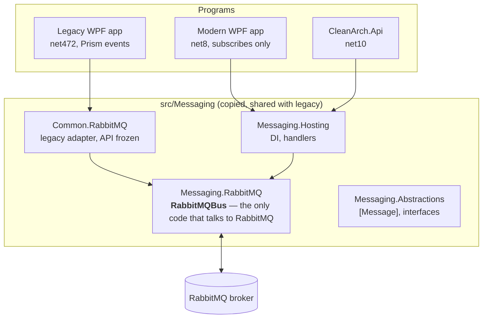
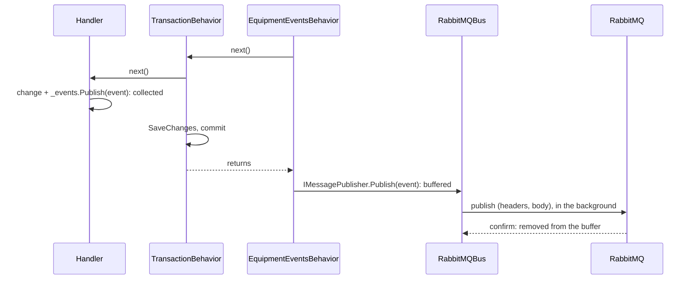

# Messaging with RabbitMQ

**Who this is for:** someone who needs the API to tell *other applications* that something
happened — a legacy WPF desktop app, a modern WPF app, another service — or who has to
maintain the messaging code and wants to know why it is shaped the way it is.

**What you'll be able to do by the end:** explain where RabbitMQ fits in this system and where
it doesn't, follow one event from a handler to a legacy desktop app, send a new event from a
module after its commit, subscribe to events from a modern WPF app, keep legacy apps
working while you do it, and diagnose the usual failures.

**What you need first:** a feature that works ([guide 20](20-add-a-feature.md)), and the
pipeline behaviors from [guide 60](60-talking-across-modules.md).
You don't need to know RabbitMQ; [chapter 3](#3-five-ideas-you-need) covers the parts you use.

> **Current state (2026-11-05).** The Equipment module is connected end to end: creating,
> updating or deleting equipment sends `EquipmentCreated` / `EquipmentUpdated` /
> `EquipmentDeleted` to RabbitMQ **and** over SignalR, both after the commit, when the API's
> `Messaging` section is configured (it is in Development). Chapters 8–12 walk through that real
> code, with real paths. Onboarding doesn't publish to RabbitMQ; the API doesn't receive messages
> yet ([chapter 13](#13-receiving-messages-in-the-api)).

---

## Table of contents

| # | Chapter | What you do there |
|---|---|---|
| 1 | [Where RabbitMQ fits, and where it doesn't](#1-where-rabbitmq-fits-and-where-it-doesnt) | Across processes, never between modules |
| 2 | [Three kinds of application, three sets of rules](#2-three-kinds-of-application-three-sets-of-rules) | Legacy, the API, modern WPF |
| 3 | [Five ideas you need](#3-five-ideas-you-need) | Just enough RabbitMQ |
| 4 | [The code map](#4-the-code-map) | Which project does what |
| 5 | [How an event leaves the API](#5-how-an-event-leaves-the-api) | Handler → commit → broker, step by step |
| 6 | [What travels on the wire](#6-what-travels-on-the-wire) | The part that must never change |
| 7 | [When things go wrong](#7-when-things-go-wrong) | Outages, lost events, duplicates |
| 8 | [Step 1 — Turn messaging on in the API](#8-step-1--turn-messaging-on-in-the-api) | Opt-in, from configuration |
| 9 | [Step 2 — Define the message](#9-step-2--define-the-message) | A plain class and a wire name |
| 10 | [Step 3 — Where it goes](#10-step-3--where-it-goes) | The default bus, keyed by the exchange name |
| 11 | [Step 4 — Send it after the commit](#11-step-4--send-it-after-the-commit) | Collect in the handler, publish once committed |
| 12 | [Step 5 — See it working](#12-step-5--see-it-working) | Health, the management UI |
| 13 | [Receiving messages in the API](#13-receiving-messages-in-the-api) | Handlers, shared queues, retries |
| 14 | [Modern WPF apps: subscribe only](#14-modern-wpf-apps-subscribe-only) | `IMessageSubscriber` |
| 15 | [Legacy apps: what they keep](#15-legacy-apps-what-they-keep) | And how the API reaches them |
| 16 | [Testing](#16-testing) | What's covered, and how to test your own |
| 17 | [The traps](#17-the-traps) | Seven ways to lose an afternoon |
| 18 | [The checklist](#18-the-checklist) | Run this when doing it for real |
| 19 | [Troubleshooting](#19-troubleshooting) | Symptom, cause, fix |
| 20 | [Cheat sheet](#20-cheat-sheet) | The moving parts, in one place |
| 21 | [Glossary](#21-glossary) | Every term used in this guide |

---

## 1. Where RabbitMQ fits, and where it doesn't

RabbitMQ carries messages **between processes**: the API, the legacy desktop apps, the modern
desktop apps. It is a separate server (the *broker*); programs connect to it, hand it
messages, and receive the messages they asked for. Sender and receiver never talk directly,
and don't have to be running at the same time.

It is **not** how modules inside the API talk to each other. That stays exactly as
[guide 60](60-talking-across-modules.md) describes:

| Talking to… | How | Why |
|---|---|---|
| Another module, a read or simple action | A published contract, e.g. `IEquipmentReservationService` — a plain method call | Same process, same lifetime; nothing to go wrong in between |
| Another module, a multi-step process | The module's outbox, delivered in-process by its dispatcher | Durable across restarts without any extra infrastructure |
| **Another application** | **RabbitMQ, published after the commit** | The other side is a different process, maybe on another machine |

Putting a broker between two modules of one process would add a network hop, a server to
run and a new way to fail, and buy nothing the outbox doesn't already give you.

---

## 2. Three kinds of application, three sets of rules

These rules exist to keep the system simple and to never break the desktop apps people use
every day.

| | Legacy WPF apps (.NET Framework 4.7.2) | The API (and future services) | Modern WPF apps (.NET 8) |
|---|---|---|---|
| **Publishes?** | Yes, to each other, as today | Yes — **only after the commit** | **No** |
| **Subscribes?** | Yes, as today | When it needs to ([chapter 13](#13-receiving-messages-in-the-api)) | Yes |
| **Library** | `Common.RabbitMQ` (the legacy adapter) | `Messaging.Hosting` | `Messaging.Hosting` (`IMessageSubscriber`) |
| **If the app crashes with unsent messages** | Lost. Accepted: users live with it, and these apps will be retired | Lost too, the same trade-off. Receivers reload from the API when it matters | Nothing to lose: they don't send |
| **What changes for them** | **Nothing.** Not the code, not the config, not the behaviour | New code goes here | New code goes here |

Two consequences run through the rest of this guide:

- Anything that would require a legacy app to change is off the table unless there is no other
  way — and then the *adapter* changes to match the legacy app, not the other way round.
- The API never announces a change that rolled back: events go out only after the commit.

---

## 3. Five ideas you need

The messaging guide's [glossary](../docs/messaging/README.md#words-you-need-glossary) uses a
post-office analogy for every term. These five are the ones that shape the code.

### 1. Exchanges, queues and bindings

A program **publishes to an exchange** — a sorting desk that stores nothing. The exchange
copies each message into every **queue** whose **binding** matches, and programs **consume**
from queues. A binding says "copy messages with this routing key from that exchange into my
queue".

```
 API ──publish──▶ [exchange: AppA] ──binding "AppA.Events.OrderSaved"──▶ (queue of AppB, instance 1) ──▶ AppB
                                   ──binding "AppA.Events.OrderSaved"──▶ (queue of AppB, instance 2) ──▶ AppB
```

### 2. The wire name says *what*; the routing key says *where*

Every message carries its **wire name** in the `event-type` header — for example
`Common.Events.EmployeeUpdated`. Receivers identify a message by it, and by nothing else: not
the exchange, not the .NET type, not the assembly.

The **routing key** decides which bindings match. By default it's the publisher's exchange name,
the same for every event, which is what legacy apps bind to. So a queue gets everything on the
exchanges it binds and drops what nothing subscribes to: one binding per exchange, however many
events there are.

Keeping the two apart is the single decision that lets legacy apps, modern apps and the API
share one system: routing can change without anyone misreading a message.

### 3. One exchange per application

Each application owns one exchange, named after it, and publishes only there. An app that
wants another app's events binds its own queue to the other app's exchange. Owners *declare*
their exchange; subscribers only *check* it exists (and wait if its owner hasn't started).

### 4. Two kinds of queue

| | Per-instance (desktop apps) | Shared (servers) |
|---|---|---|
| How many | One per running program | One per service, shared by all its instances |
| Who gets a message | Every running copy | One running copy |
| Lifetime | Deleted when the program exits | Durable, survives restarts |
| On a handler failure | Logged and dropped (legacy behaviour) | Retried, then parked in a dead-letter queue |

### 5. At least once, at most once

A message can arrive **twice**: a connection drops between delivery and the receiver's ack, and
the broker delivers it again. It can also be **lost**: the API stops with the message still in
its in-memory buffer. Receivers should tolerate a duplicate and reload state from the API when
it matters.

---

## 4. The code map

The messaging code was copied from its own repository, with the layout intact so legacy
projects can reference the adapter by the same relative path.
[PROVENANCE.md](../docs/messaging/PROVENANCE.md) records exactly what was copied and every
change since.



| Project | Target | What it is |
|---|---|---|
| `src/Messaging/Messaging.Abstractions` | net472, netstandard2.0, net8.0 | `[Message("…")]`, `IMessagePublisher`, `IMessageHandler<T>`, `MessageContext`. No dependencies — message classes reference only this. |
| `src/Messaging/Messaging.RabbitMQ` | net472, netstandard2.0, net8.0 | **The engine**, `RabbitMQBus`: connects, reconnects, declares, publishes, consumes, retries, dead-letters. |
| `src/Messaging/Messaging.Hosting` | net8.0 | Server-style setup: `AddMessaging`, handlers, `IMessageSubscriber`, System.Text.Json. |
| `src/Messaging/Messaging.Prism` | net8.0 | Optional bridge for a .NET 8 app that wants to keep Prism's `IEventAggregator` style. |
| `src/Common.RabbitMQ` | net472, net8.0 | **The legacy adapter**: the old `PublishRemote` / `IRabbitMQService` API on top of the engine. Public API is additions-only. |
| `tests/Common.RabbitMQ.Tests` | net472, net8.0 | Golden wire bytes, the legacy public API, real-broker tests. |
| `tests/Fixtures/*` | | The frozen original library, a model of the real legacy library, and demo events the golden tests need. |

### Why the messaging folders build differently

The root `Directory.Build.props` turns on net10, nullable references, implicit usings and
warnings-as-errors, and the root `Directory.Packages.props` pins newer packages. None of that
may reach code that legacy .NET Framework apps load. So `src/Messaging/Directory.Build.props`
and `src/Messaging/Directory.Packages.props` hold the messaging settings — RabbitMQ.Client
**7.1.2**, Newtonsoft.Json **12.0.3**, Prism.Core **8.1.97**, the versions the legacy apps
use — and the other copied folders import them instead of the root files.

The practical rule: **don't add a package to the root props for messaging code, and don't
"tidy up" the messaging folders into the root settings.** See
[trap 17.7](#177-tidying-the-messaging-build-into-the-root-settings).

---

## 5. How an event leaves the API

This is the path once a module is connected (chapters 8–11). Every box is code that exists.



In plain words:

1. **The handler** changes its data and calls `_events.Publish(new SomethingHappened(...))`.
   Nothing is sent: the event is collected for this request.
2. **The transaction behavior** saves and commits. If anything throws, the collected events are
   never published.
3. **The events behavior**, which wraps the transaction, publishes them once it has committed.
   `IMessagePublisher.Publish` serializes the message, buffers it and returns.
4. **The bus** sends the buffer in the background, and keeps a message until the broker confirms
   it. While the broker is down, messages wait in the buffer.

The gap: if the API stops before step 4 finishes, the event is lost although the change was
saved. An outbox (the event saved as a row in the same transaction) would close it; the API
does without one to keep things simple.

## 6. What travels on the wire

This is the contract with every other application. Tests pin it byte for byte against
**golden files**, and against a frozen copy of the original library.

| Part | Value | Who reads it |
|---|---|---|
| Routing key | The exchange name, unless the publisher sets another | The broker's bindings |
| Header `event-type` | The wire name | Every receiver: this is how it knows what the message is |
| Header `source-id` | The sending process's random ID | Desktop apps, to skip their own messages |
| Header `x-dotnet-pub-seq-no` | Added by RabbitMQ.Client | Nobody |
| `message_id` | A new GUID per message | Duplicate detection |
| `content_type` | `application/json` | |
| Body | The message object as JSON, exactly as Newtonsoft.Json 12 writes it with default settings | Every receiver |

The API writes JSON with System.Text.Json, configured to produce the same bytes as
Newtonsoft for these payloads (PascalCase names, `null`s written, numeric enums, ISO dates).
The one known difference — `12` instead of `12.0` for a whole decimal — reads back to the same
value on both sides.

**Frozen means frozen.** `event-type` and `source-id` can't be renamed or removed, and a golden
file is never regenerated to make a test pass. New headers are fine: receivers of every build
ignore headers they don't know.

---

## 7. When things go wrong

| Situation | What happens |
|---|---|
| The broker is down, or restarts | The engine checks every 5 seconds and reconnects on its own. Events wait in the buffer and go out once it's back; the log warns about each failed send. |
| The API stops with events in the buffer | They're lost. The change was saved; receivers catch up when they reload. |
| The command fails, or its commit does | Nothing is published. |
| A class without `[Message]` is published | Publishing throws after the commit: the change is saved, the event isn't sent, and the request fails. |
| A shared queue's setting changed (e.g. `DeliveryLimit`) | The broker refuses the queue. The log says *Queue 'X' already exists with different settings…* and what to do. See [trap 17.5](#175-changing-a-shared-queues-settings). |
| A receiver sees a duplicate | Expected, rarely. The receiver must tolerate it. |
| A legacy app crashes with messages in its buffer | They're lost. Accepted, and not going to change. |

---

## 8. Step 1 — Turn messaging on in the API

Messaging is **opt-in by configuration**. `Program.cs` registers it only when a `Messaging`
section exists; without one, the API behaves exactly as it did before RabbitMQ (SignalR
included), and Equipment's events are dropped.

**`src/Api/CleanArch.Api/Program.cs`** — the bus every event goes to:

```csharp
var messagingBus = builder.Configuration.GetSection("Messaging:Buses:Main");
if (messagingBus.Exists())
{
    builder.Services.AddMessaging(messaging => messaging
        .AddBus("Main", messagingBus));
}
```

**`src/Api/CleanArch.Api/appsettings.Development.json`** turns it on for local development
(production values come from environment variables, as for connection strings):

```json
"Messaging": {
  "Buses": {
    "Main": {
      "HostName": "localhost",
      "ExchangeName": "CleanArch",
      "ClientName": "CleanArch.Api",
      "QueueMode": "Shared"
    }
  }
}
```

- **No broker on your machine?** Delete the section. The API starts and works as before.
- **`ExchangeName: CleanArch`** is part of the contract: subscribers bind to it by name. The API
  declares it the first time it connects.
- **`QueueMode: Shared`** because the API is a server. The API doesn't receive messages yet, so
  its queue (`cleanarch.api.main`, plus `.dead-letter`) has no bindings; it's ready for
  [chapter 13](#13-receiving-messages-in-the-api).
- `guest` only works from the broker's own machine. Real environments need a real account with
  permission to declare exchanges and queues.

Every setting and its default is in the messaging guide's
[configuration reference](../docs/messaging/README.md#configuration-reference). Configuration
mistakes — a handler on a bus that doesn't exist, a class without `[Message]` — stop the API at
startup with a list of what's wrong.

---

## 9. Step 2 — Define the message

The module's events for other applications live in **`src/Modules/Equipment/Equipment.Messages`**:
plain classes with a wire name.

```csharp
[Message("Equipment.EquipmentCreated")]
public sealed class EquipmentCreated
{
    public Guid Id { get; set; }
    public string Name { get; set; } = "";
    public string Category { get; set; } = "";
    public string AssetTag { get; set; } = "";
    public string Status { get; set; } = "";
}
```

`EquipmentUpdated` has the same shape (the full current state, so applying it twice is
harmless); `EquipmentDeleted` carries only the `Id`.

**Why a separate project, not `Equipment.Contracts`?** `Equipment.Contracts` holds interfaces
other *modules* call in-process, and builds for net10. `Equipment.Messages` is consumed by
*desktop apps*, so it targets **netstandard2.0**, and its only reference is
`Messaging.Abstractions` (no dependencies) for the attribute. A unit test
(`TransportIndependenceTests`) fails if it ever references anything else.

**One contract, both channels.** The same classes travel over RabbitMQ and
SignalR (the hub). A client reads `EquipmentCreated` the same way whichever it listens to.

### Choosing the wire name

| The message is… | Wire name | Why |
|---|---|---|
| **New**, only modern apps receive it (Equipment's are) | Explicit and stable: `Equipment.EquipmentCreated` | Not tied to the namespace, so moving the class can't break anyone |
| **Received by a legacy app** | **Exactly** the legacy event's full .NET type name, e.g. `AppA.Events.OrderSaved` | Legacy apps identify events by their type's full name. Anything else is ignored |

### Shaping the payload

- **Public properties with getters and setters**, and a parameterless constructor. No public
  fields, no get-only collections, no properties typed as a base class or interface: those
  are exactly the places System.Text.Json and Newtonsoft behave differently.
- **For a legacy receiver**, property names and types must match the legacy payload class
  (the `T` in its `PubSubEvent<T>`) — casing included.
- **Ids and facts, not whole aggregates.** Receivers that need more ask for it.
- **Never rename a property** once anything receives it. Add new ones instead.

---

## 10. Step 3 — Where it goes

Nowhere to register it, because a message doesn't belong to a bus. It goes to the default bus
(`Main`, the API's only one), with the exchange name as the routing key. Every application names its
default in configuration, with `Messaging:DefaultBus`; it's required, even with one bus. The publisher can override
either for one call:

```csharp
publisher.Publish(order, new PublishOptions { RoutingKey = "orders.eu.saved" });
publisher.Publish(order, new PublishOptions { Bus = "Partners" });
```

Equipment's events always go to the default bus.

**Keep the wire name as the key.** Keep it for anything a legacy app must receive: legacy apps bind
one key per event (its full name), so a custom key never reaches them. Custom keys are for new
subscribers that bind patterns such as `orders.*.saved`.

A routing-key convention is a contract with every subscriber. Changing it doesn't make anyone
misread a message — they just stop *getting* it.

**Division of labour:** the handler says **what** happened; the host says **where** it goes
(its default bus). Neither the handler nor the domain knows RabbitMQ exists.

---

## 11. Step 4 — Send it after the commit

This is how Equipment is connected. Each piece is small, and each sits in the layer it belongs to.

**1. A collector interface** — Application layer, `Equipment.Application/Abstractions/IEquipmentEvents.cs`:

```csharp
public interface IEquipmentEvents
{
    void Publish<TEvent>(TEvent integrationEvent) where TEvent : class;
}
```

**2. The handler says what happened, twice over** — `CreateEquipment.cs` (Update and Delete are
the same shape):

```csharp
var created = new EquipmentCreated
{
    Id = asset.Id,
    Name = asset.Name,
    Category = asset.Category.ToString(),
    AssetTag = asset.AssetTag,
    Status = asset.Status.ToString(),
};
_events.Publish(created);
_realtime.Publish(RealtimeGroups.Equipment(), new RealtimeEvent(nameof(EquipmentCreated), created));
```

Two calls, two channels — and **neither sends anything yet**. Both are collected for the request
and sent by a behavior that wraps the transaction, once it has committed:

| Call | Sent by | To |
|---|---|---|
| `_events.Publish` | `EquipmentEventsBehavior` | RabbitMQ, through `IMessagePublisher` |
| `_realtime.Publish` | `RealtimeDispatchBehavior` | SignalR |

A rolled-back change sends nothing on either channel.

**3. The collector and the behavior** — Infrastructure: `IntegrationEvents/EquipmentEvents.cs`
holds the events for the request, and `Behaviors/EquipmentEventsBehavior.cs` publishes them after
`next()` returns. `DependencyInjection.cs` registers the behavior **before**
`TransactionBehavior`, so it runs outside the transaction:

```csharp
services.AddScoped<EquipmentEvents>();
services.AddScoped<IEquipmentEvents>(provider => provider.GetRequiredService<EquipmentEvents>());
services.AddScoped(typeof(IPipelineBehavior<,>), typeof(EquipmentEventsBehavior<,>));
services.AddScoped(typeof(IPipelineBehavior<,>), typeof(TransactionBehavior<,>));
```

The behavior takes `IMessagePublisher` as an optional dependency. Without messaging configured
there is none, and the events are dropped — nothing to switch on or off in the module.

---

## 12. Step 5 — See it working

### Run it

1. RabbitMQ running on `localhost:5672`.
2. `dotnet run --project src/Api/CleanArch.Api` — in Development, with the `Messaging` section.
3. Open the POC windows from [`samples/MessagingPocs`](../samples/MessagingPocs/README.md),
   then add or delete equipment (Swagger, `curl`, or any window's buttons). SignalR windows
   update at once, and so do the RabbitMQ windows (net472, net8, net10).

### Logs and metrics

The messaging library logs through `ILogger` and exports no traces or metrics of its own.
RabbitMQ's own metrics cover the queues.

### Health

There's no messaging health check. A broker outage shouldn't take the API out of service: the
bus already absorbs it (events wait in its buffer and go out on reconnect). Broker status comes
from RabbitMQ's own metrics and the log.

### The management UI

`http://localhost:15672` (guest/guest on a local broker):

- **Exchanges** — `CleanArch` exists, type `topic`.
- **Queues** — each subscriber's queue, and its **Bindings** tab: is there a binding for your
  wire name or pattern?
- **Get messages** on a queue you own, with *Ack mode: Nack message requeue true* so you only
  look — shows headers, message-id and body.

---

## 13. Receiving messages in the API

> Not needed yet: build it when the API first has to react to another application.

A handler is an ordinary class, resolved in its **own DI scope per message**:

```csharp
public sealed class CustomerChangedHandler : IMessageHandler<CustomerChanged>
{
    public async Task Handle(CustomerChanged message, MessageContext context, CancellationToken cancellationToken)
    {
        // throw to fail the message: it is retried, then dead-lettered
    }
}

messaging.AddHandlers(typeof(CustomerChangedHandler).Assembly);   // picks up every IMessageHandler<T> in it
messaging.Subscribe("AppB");                  // bind the queue to AppB's exchange, once, keyed "AppB"
messaging.Subscribe("AppB", "AppB.Events.#"); // …or a pattern
```

On a **shared queue** (the API's):

- each message goes to **one** instance of the API;
- a handler that throws is retried in the process `MaxAttempts` times (3), `RetryDelay` apart
  (1 s), then moved to `<queue>.dead-letter`;
- a body that isn't valid JSON goes straight to the dead-letter queue;
- a message that keeps **crashing the process** is dead-lettered by the broker after
  `DeliveryLimit` (5) lost deliveries.

Two things to keep in mind:

- **In-memory state diverges** when there's more than one instance, because each message goes
  to only one of them. State that every instance needs belongs in the database or a shared
  cache.
- **Handlers aren't mediator requests.** If a handler should run a module's use case, it
  sends a command through the mediator itself; there's no automatic bridge yet.

---

## 14. Modern WPF apps: subscribe only

A modern desktop app uses the .NET Generic Host, `Messaging.Hosting` and the same plain message
classes as the API. It never resolves `IMessagePublisher`, so it never publishes. Full walk-through:
recipe C in the [messaging guide](../docs/messaging/README.md#c-a-modern-wpf-app-without-prism-net-8).

> **Runnable comparison.** [`samples/MessagingPocs`](../samples/MessagingPocs/README.md) has three
> small WPF apps side by side — RabbitMQ through Prism's `IEventAggregator`, RabbitMQ without it,
> and **SignalR from the API** — with the right approach and the pitfalls commented in the code.
> For apps whose events all come from the API, SignalR is the simpler default: no broker account or
> broker access on each desktop.

```csharp
// App.xaml.cs
builder.Services.AddMessaging(messaging => messaging
    .AddBus("Main", builder.Configuration.GetSection("Messaging:Buses:Main")));

// A view model
public MainWindowViewModel(IMessageSubscriber subscriber)
{
    // Posted to the UI thread, like Prism's ThreadOption.UIThread.
    _subscription = subscriber.Subscribe<EquipmentCreated>(OnCreated, SynchronizationContext.Current);
}
```

- **Its config** points `ExchangeName` at the app's own name, and a `Subscriptions` entry at
  the API's exchange, `CleanArch`.
- **Reload after a reconnect,** not only at start-up: a desktop app's queue is deleted when its
  connection drops, so events sent in the meantime are gone.
- **Per-instance queue** (the default): every running copy gets every message, and the queue
  disappears when the app closes. Messages sent while it was closed aren't waiting for it —
  on start-up, load current state from the API, then apply events on top.
- **Dispose the subscription** when a window or view model goes away. Subscriptions are strong
  references, unlike Prism's weak ones.
- An exception in a UI-thread subscriber goes to `Application.DispatcherUnhandledException`,
  not back to the message.
- Each app keeps one idle publisher connection. Harmless; not worth an option unless the broker's
  connection count ever becomes a concern.

---

## 15. Legacy apps: what they keep

**Everything.** Their code, their Prism events, their buffered publishing,
and what happens when they close or crash. The adapter (`src/Common.RabbitMQ`) keeps the old
public API; a test fails if anything is removed or changed, and each addition has to be
listed with a reason.

What the adapter *added* — events found by assembly instead of an attribute on each one,
`PublishOptions`, `SubscribeOptions` and `Subscriptions` in appsettings.json — is opt-in, and none of it
is needed for an app to keep working.

### How the API reaches a legacy app

Three things must line up, and none of them requires touching the legacy app:

1. **The wire name** is the legacy event's full type name ([chapter 9](#choosing-the-wire-name)).
2. **The payload** has the same property names and types as the legacy payload class.
3. **The routing key** is the default (the exchange name), and the message arrives on **an exchange
   the legacy app already listens to.**

The third is the one decision still open (open question 4 in
[ADR 0002](../docs/messaging/adr/0002-exchange-per-owner-and-configurable-routing.md#open-questions),
and item D2 of the work verification checklist):

| Option | What it takes | Trade-off |
|---|---|---|
| The API publishes into the **owning legacy app's exchange** (API bus `ExchangeName` = that app's) | Nothing on the legacy side | Proposed default: no config change anywhere. The API "speaks for" that app's domain |
| The API publishes into **its own exchange** | Every legacy app that wants the event adds a `<subscribe exchange="CleanArch" />` | Cleaner ownership, but touches legacy configuration |

### What legacy apps can't get

- **Custom routing keys.** They bind each exchange with its owner's name only.
- **Anything from a non-`topic` exchange** they subscribe to — keep `topic` wherever a legacy
  app listens.

### What's still an assumption

The legacy side of the tests runs against a *model* of the real legacy library, built from
confirmed facts and named assumptions (A1–A16 in
[legacy-baseline-assumptions.md](../docs/messaging/legacy-baseline-assumptions.md)). Until
they're checked against the real library at work, "compatible" means "compatible with the
model". The most important unknowns: the real library's class names and constructor, whether
legacy messages are persistent, and whether payload classes use Newtonsoft attributes.

---

## 16. Testing

### What exists

| Suite | What it proves | Needs a broker? |
|---|---|---|
| `tests/Common.RabbitMQ.Tests` — `Golden` | Bodies are byte-for-byte what legacy apps expect | No |
| `…/PublicApi` | The legacy adapter lost nothing; only approved additions | No |
| `…/Broker` | The engine against a real broker: delivery, echo drop, queues, retries, dead-letters | Yes |
| `…/Hosting` | `AddMessaging`, handlers, `IMessageSubscriber` (net8 only) | Yes |
| `…/LegacyModel`, `…/Adapter` | The new code working with the model of the real legacy library | Yes |
| `tests/CleanArch.Api.IntegrationTests` — `EquipmentIntegrationEventsTests` | The real module and pipeline with a fake publisher: events go out after the commit, and not at all when it fails | No |

Run the messaging suite against a broker, with skips turned into failures:

```powershell
$env:RABBITMQ_TESTS_REQUIRED = '1'
dotnet test tests/Common.RabbitMQ.Tests     # net472 AND net8.0 must both pass
```

Without a broker, broker tests are **skipped** — which is why CI-style runs set
`RABBITMQ_TESTS_REQUIRED=1`. Point at another broker with `RABBITMQ_HOST`, `RABBITMQ_PORT`,
`RABBITMQ_VHOST`, `RABBITMQ_USER`, `RABBITMQ_PASSWORD`.

### When a test fails

| Test | Meaning | Do |
|---|---|---|
| Golden files | The bytes on the wire changed | Fix the code. **Never regenerate a golden file to pass** |
| Public API | The legacy adapter's surface changed | Removals aren't allowed. A new public member goes in `ApprovedAdditions` with a reason |
| Legacy model | Behaviour differs from what we believe the real library does | Change the model, the assumptions doc and the named test **together** |
| `tests/Fixtures/Common.RabbitMQ.Baseline` | *(never edit)* | It's the original library, kept as the reference |

### Testing your own module's events

You don't need a broker to test a module that sends events. Register a fake `IMessagePublisher`
that records what it's given — `EquipmentIntegrationEventsTests` has one. Then assert on what it
received after the command: the message's fields, and that nothing was published when the
command failed. In handler unit tests, a fake `IEquipmentEvents` is enough.

For a new guarantee, check the test really catches its absence: break the code on purpose,
watch the test fail, put it back.

### A broker on your machine

RabbitMQ 4.3.6 on Erlang/OTP 28.5.0.6, installed natively (there's no Docker here). Install
and start-up steps: [Running it on your machine](../docs/messaging/README.md#running-it-on-your-machine).

---

## 17. The traps

### 17.1 Calling `IMessagePublisher.Publish` from a handler

It sends before the commit, so other apps can hear about a change that then rolls back. Collect
the event with `IEquipmentEvents` instead ([chapter 11](#11-step-4--send-it-after-the-commit)).

### 17.2 Changing a wire name

The wire name in `[Message("…")]` is what receivers know. Changing it means every receiver stops
recognising the message. Treat it as permanent; renaming the class itself is harmless.

### 17.3 A custom routing key on an event a legacy app needs

The legacy app binds the wire name; the message goes out with a different key; the broker
delivers it nowhere near the legacy app. Nothing errors. Keep the default key for anything
legacy apps receive.

### 17.4 Assuming exactly once

Duplicates are rare but real. A receiver that, say, sends an email on every `EmployeeHired`
must check it hasn't already sent one for that message-id or that employee.

### 17.5 Changing a shared queue's settings

`DeliveryLimit` and the dead-letter settings are fixed when a shared queue is created. Change
them later and the broker refuses the queue; the log says so and what to do. Either put the
setting back, or delete the queue (and its dead-letter queue) so they're created again — which
loses any messages waiting in them.

### 17.6 Changing an exchange's type

Legacy apps may re-declare the exchanges they subscribe to as `topic` (assumption A16). An
exchange that becomes `direct` or `fanout` locks them out with a `PRECONDITION_FAILED` error.
Keep `topic`.

### 17.7 Tidying the messaging build into the root settings

It looks like harmless consolidation. It would switch the legacy-shared code to nullable,
implicit usings, warnings-as-errors and newer package versions — and legacy apps would get
assemblies they can't load, or behaviour they didn't have. Leave `src/Messaging/Directory.*.props`
alone.

---

## 18. The checklist

When connecting a new event:

- [ ] The event matters to **another application**. (Between modules, use
      [guide 60](60-talking-across-modules.md) instead.)
- [ ] The message class is in the sending module's `*.Contracts`, with `[Message("…")]`.
- [ ] Wire name: the legacy event's full type name if a legacy app receives it, otherwise
      explicit and namespace-free.
- [ ] Payload: public get/set properties only; names and types match the legacy payload
      where one exists.
- [ ] The handler collects the event (`IEquipmentEvents`) — never calls a publisher directly.
- [ ] Every receiver tolerates a duplicate, and a lost event.
- [ ] A test with a fake `IMessagePublisher` covers what is sent.
- [ ] `dotnet test tests/Common.RabbitMQ.Tests` with `RABBITMQ_TESTS_REQUIRED=1` is green on
      net472 and net8.0 — especially if anything under `src/Messaging` changed.
- [ ] Anything that changed the copied code is recorded in
      [PROVENANCE.md](../docs/messaging/PROVENANCE.md).

---

## 19. Troubleshooting

| Symptom | Likely cause | Fix |
|---|---|---|
| Log: *Publishing … failed; it stays buffered and is retried* | The API can't reach the broker | Check the broker and credentials. Events go out by themselves once it's back, if the API keeps running |
| An event goes out but a legacy app never sees it | Wrong wire name; a custom routing key; or it's on an exchange the app doesn't bind | Compare `event-type` with the legacy type's full name; check the queue's bindings in the management UI |
| A legacy app receives it but fields are empty | Property names or types don't match the legacy payload | Match them exactly, including case |
| A modern app receives nothing | Not subscribed to the API's exchange; nothing calls `Subscribe` for the type; or the app wasn't running when it was sent | Check `Subscriptions` and the `Subscribe` call; load state on start-up |
| Log: *Exchange 'X' does not exist yet; waiting for its owner* | The app that owns exchange X hasn't started | Start it; the subscriber connects on its own |
| Log: *Queue 'X' already exists with different settings* | A shared-queue setting changed | [Trap 17.5](#175-changing-a-shared-queues-settings) |
| Log: *PRECONDITION_FAILED … inequivalent arg 'type'* | Two apps declared one exchange with different types | Make them agree — keep `topic` |
| Log: *NOT_ALLOWED – vhost X not found* | The virtual host doesn't exist | Use `/`, or create it |
| Messaging tests show as **skipped** | No broker reachable | Start RabbitMQ; set `RABBITMQ_TESTS_REQUIRED=1` so it fails instead |
| Visual Studio shows messaging files with a red cross | Files deleted and restored while the solution was open | Unload and reload the project, or reopen the solution |
| Build: *OutOfMemoryException* or a hang | A stale MSBuild node | `dotnet build-server shutdown`, or build with `-nr:false` |

---

## 20. Cheat sheet

### The API, sending

```csharp
// Program.cs — only when "Messaging:Buses:Main" is configured
builder.Services.AddMessaging(m => m
    .AddBus("Main", messagingBus));            // every event goes here, keyed by the exchange name

// Handler (inside the unit of work): the same event, both channels, both sent after the commit
_events.Publish(created);                                                            // RabbitMQ
_realtime.Publish(RealtimeGroups.Equipment(), new RealtimeEvent(nameof(EquipmentCreated), created));  // SignalR
```

### A modern WPF app, receiving

```csharp
services.AddMessaging(m => m
    .AddBus("Main", configuration.GetSection("Messaging:Buses:Main")));

IDisposable sub = subscriber.Subscribe<EquipmentCreated>(OnCreated, SynchronizationContext.Current);
```

### The numbers

| | Value |
|---|---|
| Reconnect check | every 5 s |
| Shared queue: handler attempts / delay / crash guard | 3 / 1 s / 5 lost deliveries |
| Package versions (messaging) | RabbitMQ.Client 7.1.2, Newtonsoft.Json 12.0.3, Prism.Core 8.1.97 |
| Broker used here | RabbitMQ 4.3.6, Erlang/OTP 28.5.0.6 |

### Where to read more

| For | Read |
|---|---|
| Every option, header, recipe and failure mode of the library | [docs/messaging/README.md](../docs/messaging/README.md) |
| Why the layers exist | [ADR 0001](../docs/messaging/adr/0001-decouple-messaging-from-prism.md) |
| Exchange per app, routing keys, events by assembly | [ADR 0002](../docs/messaging/adr/0002-exchange-per-owner-and-configurable-routing.md) |
| The outbox design the API used until 2026-11-05 (superseded) | [ADR 0003](../docs/messaging/adr/0003-server-publishes-through-the-outbox.md) |
| What we believe about the real legacy library | [legacy-baseline-assumptions.md](../docs/messaging/legacy-baseline-assumptions.md) |
| Where the code came from, and what changed since | [PROVENANCE.md](../docs/messaging/PROVENANCE.md) |

---

## 21. Glossary

| Term | Meaning here |
|---|---|
| **Broker** | The RabbitMQ server. |
| **Exchange** | Where messages are published. Stores nothing; copies each message to the queues whose bindings match. One per application. |
| **Queue** | Where messages wait until a program takes them. |
| **Binding** | A rule linking a queue to an exchange: "copy messages whose routing key matches this". |
| **Routing key** | The label bindings match on. Decides *where* a message goes. Defaults to the publisher's exchange name. |
| **Wire name** | The message's identity, in the `event-type` header. Decides *what* a message is. |
| **Per-instance queue** | One private, temporary queue per running desktop app. Every copy gets every message. |
| **Shared queue** | One durable queue shared by all instances of a service. Each message goes to one instance. |
| **Dead-letter queue** | `<queue>.dead-letter`: where a shared queue parks messages that keep failing. |
| **Buffer** | The bus's in-memory list of messages not yet confirmed by the broker. Lost if the process stops. |
| **Duplicate** | The same message delivered twice, after a dropped connection. Receivers must tolerate it. |
| **Legacy adapter** | `src/Common.RabbitMQ`: the old API on top of the new engine, so legacy apps don't change. |
| **Golden file** | A saved copy of the exact bytes legacy apps expect, compared byte for byte by tests. |
| **Echo** | A desktop app receiving the message it just sent. Per-instance queues drop it. |

---

## Appendix — The files involved

```
src/Messaging/
├── Directory.Build.props / Directory.Packages.props   build isolation and legacy package versions
├── Messaging.Abstractions/MessageAttribute.cs          [Message("wire name")]
├── Messaging.RabbitMQ/RabbitMQBus.cs                   the engine: Enqueue (buffered)
├── Messaging.Hosting/MessagingServiceCollectionExtensions.cs   AddMessaging
├── Messaging.Hosting/MessagingBuilder.cs               AddBus, Handle, Subscribe, AddMessages
├── Messaging.Hosting/MessagePublisher.cs               IMessagePublisher
└── Messaging.Hosting/IMessageSubscriber.cs             for desktop apps

src/Common.RabbitMQ/                   the legacy adapter (public API frozen, additions only)

The worked example — Equipment, both channels:
src/Modules/Equipment/Equipment.Messages/            EquipmentCreated / Updated / Deleted (netstandard2.0)
src/Modules/Equipment/Equipment.Application/Abstractions/IEquipmentEvents.cs
src/Modules/Equipment/Equipment.Application/Inventory/  Create / Update / Delete: events + real-time
src/Modules/Equipment/Equipment.Infrastructure/IntegrationEvents/EquipmentEvents.cs   the collector
src/Modules/Equipment/Equipment.Infrastructure/Behaviors/EquipmentEventsBehavior.cs   publishes after the commit
src/Api/CleanArch.Api/Program.cs                     AddMessaging, only when configured

tests/Common.RabbitMQ.Tests/           golden, public API, broker, hosting, legacy model
tests/CleanArch.Api.IntegrationTests/EquipmentIntegrationEventsTests.cs
tests/CleanArch.UnitTests/TransportIndependenceTests.cs   inner layers never reference a transport
samples/MessagingPocs/                 three WPF apps receiving the same events three ways
docs/messaging/                        the library guide, ADRs 0001–0003, assumptions, provenance
```

---

## Where to go next

- **[Talking across modules](60-talking-across-modules.md)** — how modules inside the API talk
  without a broker.
- **[Instrumenting an application](50-instrumenting-an-application.md)** and
  **[Reading your telemetry](95-reading-your-telemetry.md)** — where the broker's metrics end up, and how to read them.
- **[Testing](80-testing.md)** — the general approach the messaging tests follow.
- **[The messaging guide](../docs/messaging/README.md)** — the library's own reference, for
  every option and failure mode.
